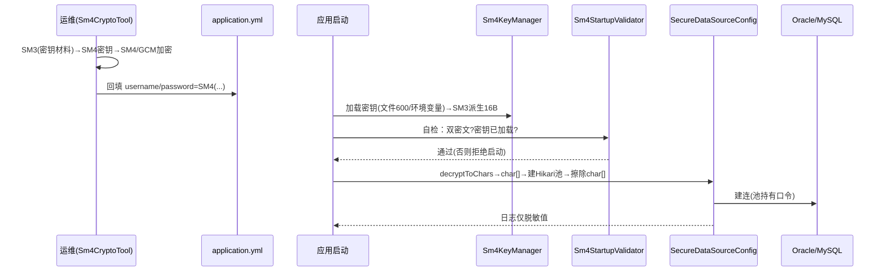

# 数据源国密加固说明（springBootTemplatte，单数据源 SM4）

> 对应监管两张图：图一要求优先国密（SM4-128 对称加密口令），图二 4 条安全性要求。
> 口径：JDK17 / Hutool 5.8.26 / `bcprov-jdk18on` 1.78.1 / MyBatis + MyBatis-Plus / 无 Nacos（配置全在 `application.yml`）/
> 只加密 `username/password` / 无密钥分片（单密钥：环境变量 `SM4_KEY` 或 600 权限密钥文件二选一）。

## 1. 类与配置一览

| 类 / 文件 | 职责 |
|---|---|
| `crypto.SmCryptoException` | 统一异常：缺密钥、明文违规、文件权限不满足、篡改，一律抛此异常拒绝启动/拒绝解密，异常信息不回显明文 |
| `crypto.Sm4Properties` | `sm4.*` 配置绑定：`enabled/key-env/key-file/strict-file-permission/log-key-loaded` |
| `crypto.Sm4KeyManager` | 单密钥加载：`key-file` 优先否则环境变量；`SM3(材料)` 取前 16 字节派生 SM4-128；原料立即擦除；`destroy()` 擦除常驻密钥 |
| `crypto.Sm4CipherService` | `SM4-128/GCM/NoPadding` 加解密，密文 `SM4(Base64(IV12字节\|\|密文\|\|Tag16字节))`，随机 IV，`decryptToChars()` 返回 `char[]` 供擦除 |
| `crypto.SensitiveMaskUtils` | 日志脱敏：口令恒 `******`、用户名留首字符、JDBC URL 掩盖 `password=/user=` |
| `config.SecureDataSourceConfig` | 显式单数据源建池：解密 `username/password` → 建 `HikariDataSource` → 建池后 `Arrays.fill` 擦除；日志只打脱敏值 |
| `crypto.Sm4StartupValidator` | 启动自检（`ApplicationRunner`，最高优先级）：缺配置/明文/缺密钥 fail-fast |
| `crypto.Sm4CryptoTool` | 运维离线加密工具：密钥经环境变量/文件/参数进入，输出 `SM4(...)` 回填 yml |
| `application.yml` | `spring.datasource.username/password` 只允许 `SM4(...)`（生产）或明文（仅 `sm4.enabled=false` 本地）；`mapper-locations: classpath*:mappings/*.xml` 由 starter 自动装配，无需配置类手动指定 |

## 2. 整体加解密流程

### 2.1 加密流程（运维侧，离线一次完成，不经过开发）

```text
运维安全终端
  │  ① 准备密钥材料（运维保险柜生成，任意长度字符串，如 32 位随机串）
  │     提供方式三选一：环境变量 SM4_KEY ｜ 密钥文件 /run/secrets/sm4.key ｜ --key 参数（会留历史，不推荐）
  ▼
Sm4CryptoTool.main()
  │  ② 读取密钥材料 bytes ──→ SM3(材料) ──→ 取前16字节 → SM4-128 会话密钥 key
  │     （材料用后 Arrays.fill 擦除；密钥只驻留本次 JVM 内存）
  ▼
Sm4CipherService.encrypt(用户名明文 / 口令明文)
  │  ③ SecureRandom 生成 12 字节 IV
  │  ④ GCMBlockCipher(SM4Engine).init(加密, key, IV) → IV‖密文‖Tag(16B) → Base64 → 包 SM4(...) 
  │     （同一明文每次 IV 不同，密文不同；key/iv/src 用后擦除）
  ▼
输出 SM4(...) ──→ 人工回填 application.yml 的 username/password ──→ 提交 Git（Git 中只有密文）
```

示例：

```bash
# 推荐：密钥走环境变量， 待加密串走参数（或无参数交互输入，避免进 history）
export SM4_KEY='换成运维保险柜里的密钥材料'
java -cp app.jar org.template.crypto.Sm4CryptoTool 'scott' 'Tiger_2026!'
# 输出两行 SM4(...)，分别回填 username / password

# 密钥文件方式（文件需 chmod 600）
java -cp app.jar org.template.crypto.Sm4CryptoTool --key-file /run/secrets/sm4.key 'scott'
```

### 2.2 启动解密流程（应用侧，每次启动执行）

```text
Spring Boot 启动
  │
  ├─ ① Sm4Properties 绑定 sm4.*（enabled/key-env/key-file/...）
  │
  ├─ ② Sm4KeyManager 初始化
  │     key-file 非空？ ──是──→ 文件存在？否→抛异常拒绝启动
  │        │                        是→校验 600 权限（非 600 抛异常；Windows 非POSIX 跳过+告警）
  │        │                             →读文件→trim→SM3派生16字节→擦除原料
  │        └─否──→ 读环境变量 SM4_KEY →为空→sm4Key=null（待自检拒绝）
  │                →非空→SM3派生16字节→擦除原料
  │
  ├─ ③ Sm4StartupValidator.run()（HIGHEST_PRECEDENCE）
  │     username/password 为空→拒绝 ｜ sm4.enabled=false+出现密文→拒绝
  │     sm4.enabled=true 时：密钥未加载→拒绝；username/password 任一明文→拒绝
  │
  ├─ ④ SecureDataSourceConfig.dataSource()
  │     读 spring.datasource.url/username/password
  │     resolveSecret(): SM4(...)→decryptToChars()→char[]；明文→enabled=true则拒绝/=false则告警放行
  │     new String(chars)→设入 HikariConfig→new HikariDataSource→建池连库
  │     finally: Arrays.fill(usernameChars/passwordChars) 置空；日志只打 maskUsername/maskJdbcUrl
  │
  └─ ⑤ MyBatis-Plus Starter 用该 DataSource 自动装配 SqlSessionFactory
        （mapper-locations/type-aliases-package 由 starter 读 yml，无需手动 set）
```

时序（生产正常路径）：



### 2.3 内存擦除点（对应监管第 3 条）

| 位置 | 擦除动作 |
|---|---|
| `Sm4KeyManager.loadAndDerive/loadMaterial` | 原始材料 `material/raw` 用后 `Arrays.fill(..., 0)` |
| `Sm4KeyManager.destroy()` | 应用关闭时擦除常驻 16 字节 `sm4Key` |
| `Sm4CipherService.encrypt/decrypt` | `key/iv/src/plain/out` 等副本在 `finally` 中擦除；`decrypt()` 内 `char[] arr` 拷贝后擦除 |
| `SecureDataSourceConfig.dataSource()` | `usernameChars/passwordChars` 在 `finally` 中擦除，局部 `String` 引用断开 |
| `Sm4CryptoTool` | `material` 在 `finally` 中擦除；交互输入的 `char[]` 擦除 |

> 已知限制：`HikariConfig.setUsername/Password(String)` 接口只收 `String`，
> 池对象内部持有的明文无法从外部擦除，这是 Hikari API 限制下的最优解；
> 缓解措施：局部变量已擦除+断引用，日志全脱敏，`application.yml`+密钥文件走 600 权限。

### 2.4 日志与权限（对应监管第 2、4 条）

- 日志：`SecureDataSourceConfig` 只打印 `maskJdbcUrl(url)` + `maskUsername(username)`，
  密钥只打“已加载/未启用”状态；`logging.level.root=info`，`mapper debug` 只打 SQL，
  业务代码凡涉及用户名/口令必须经 `SensitiveMaskUtils`。
- 文件权限：密钥文件要求 `600`（`strict-file-permission=true`，否则拒绝启动）；
  `application.yml` 生产投放同样要求 `600` 且最小授权（由运维/发布流水线保障，应用侧对 yml 本身不做 chmod）。

## 3. 投产操作清单

1. 本地联调：`sm4.enabled=false` + 明文 `username/password` 跑通功能。
2. 生产加密：运维在安全终端设 `SM4_KEY`，用 `Sm4CryptoTool` 分别加密用户名、口令，
   回填 `username: SM4(...)` / `password: SM4(...)`，切 `sm4.enabled=true`。
3. 生产投放：`SM4_KEY` 经 K8s Secret/保险柜注入（或投放 600 密钥文件配 `sm4.key-file`），
   `application.yml` 设 600，验证缺密钥/明文/坏权限三场景均拒绝启动。
4. 单测：`Sm4CipherServiceTest`（既有 6 用例）+ 新增
   `Sm4KeyManagerTest` / `SensitiveMaskUtilsTest` / `Sm4StartupValidatorTest`。

## 4. 为什么这样选型（给监管的口径）

- 图一对称算法中只有 `SM4/AES` 可逆且适合包口令，散列不可逆、非对称不适合逐字段解密，
  故口令加密选 `SM4-128`（优先国密），`AES` 备选，`3DES` 弃用；`SM2` 留给密钥分发场景。
- `Jasypt ENC()` 不支持 SM4，故自研 `SM4(...)` 前缀兼容形态，未保留 `ENC()` 双轨
  （如存量配置有 `ENC()`，需先用 Jasypt 解出明文再用本工具转 `SM4(...)`）。
- 模式定 `SM4/GCM/NoPadding`：随机 IV 防重放分析，GCM Tag 防篡改，篡改即解密失败拒绝建连。
